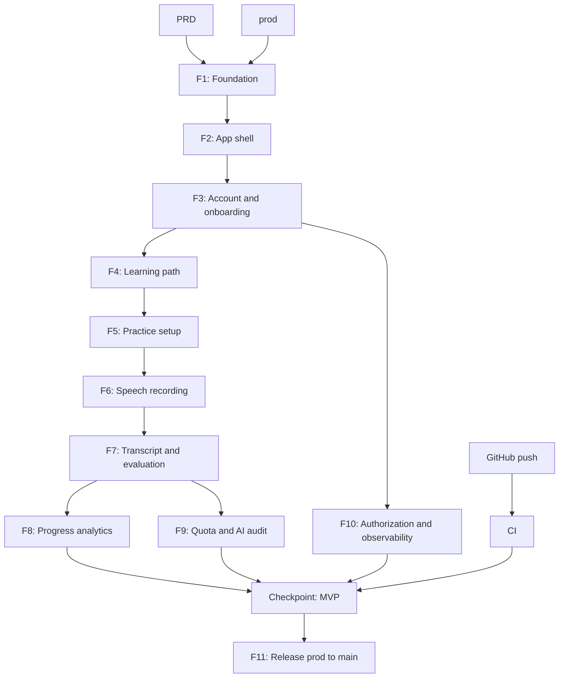

# Argumenta Implementation Plan

## Overview

Bangun AI Debate Coach sebagai PWA mobile-first memakai Laravel 13, Inertia,
Vue 3, TypeScript, Tailwind CSS, dan MySQL. Implementasi memakai vertical
slice agar tiap tahap menghasilkan alur yang bisa dijalankan dan diverifikasi.

## Architecture decisions

- Laravel 13 menjadi backend, routing, auth, queue, dan SSR shell.
- Inertia + Vue 3 menjadi UI tanpa runtime SSR Node di production.
- MySQL menjadi persistence utama sesuai PRD dan target cPanel.
- MediaRecorder mengirim audio ke private object storage melalui Laravel.
- Provider AI dibungkus adapter typed agar model dapat diganti.
- `prod` menjadi branch eksekusi. `main` hanya menerima perubahan terverifikasi.

## Dependency graph

## Ordered task list

### Phase 1: Foundation

1. F1 Foundation
2. F2 App shell
3. Checkpoint Foundation

### Phase 2: Core user flow

4. F3 Account and onboarding
5. F4 Learning path
6. F5 Practice setup
7. Checkpoint Core navigation

### Phase 3: Speech MVP

8. F6 Speech recording
9. F7 Transcript and evaluation
10. F8 Progress analytics
11. Checkpoint Speech MVP

### Phase 4: Reliability and release

12. F9 Quota and AI audit
13. F10 Authorization and observability
14. Checkpoint Release readiness
15. F11 Release `prod` to `main`

## Risks and mitigations

| Risk | Impact | Mitigation |
|---|---|---|
| PHP/Composer unavailable locally | High | Document prerequisite; use CI with PHP setup |
| AI provider output varies | High | Typed schema validation, adapter, retry budget |
| Audio privacy failure | Critical | Private storage, authorization tests, signed URLs |
| cPanel worker limits | Medium | Database queue and cron-compatible jobs |
| Mobile recording interruption | High | Explicit session states and resumable upload design |

## Open questions

- Provider STT dan object storage final belum dipilih.
- Mekanisme auth production perlu disesuaikan dengan hosting cPanel.
- Payment provider belum termasuk scope MVP.
